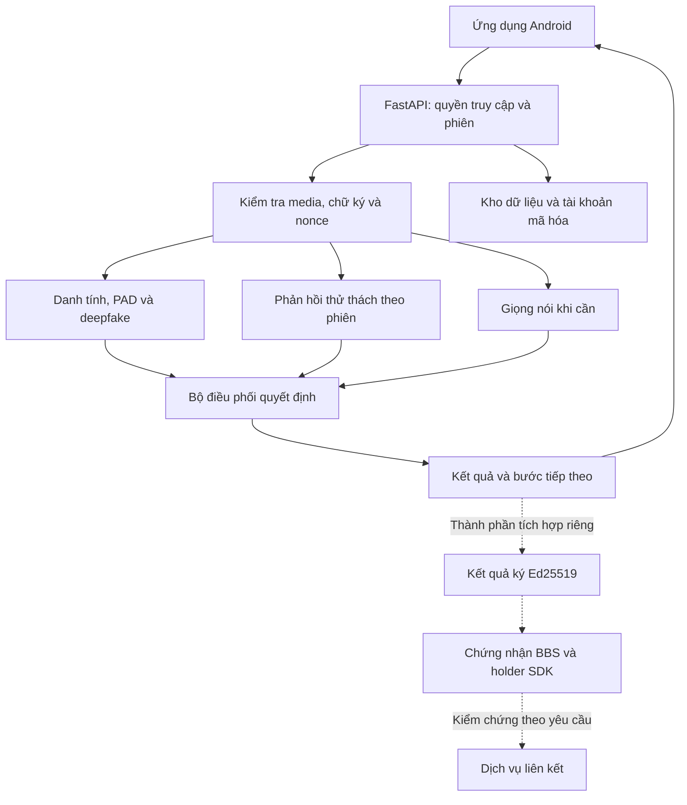

<div align="center">

# VeriClue

### Xác minh tin cậy. Chia sẻ chủ động.

**Nền tảng xác minh danh tính số đa lớp cho hệ sinh thái dịch vụ số.**

Khuôn mặt và giọng nói · Bằng chứng theo phiên · Bảo vệ dữ liệu · Chia sẻ có chọn lọc

**DS@AInSec4E — Data for Life 2026 — BTL86-16**

[Trải nghiệm](#trải-nghiệm-ứng-dụng) · [Kiến trúc](#kiến-trúc-hệ-thống) · [Bảo mật](#bảo-mật-theo-từng-lớp) · [Bắt đầu](#bắt-đầu-phát-triển) · [Đóng góp](CONTRIBUTING.md)

</div>

## Một hành trình định danh có kiểm soát

VeriClue kết nối thu nhận dữ liệu, phân tích danh tính và bảo vệ bằng chứng trong
một hành trình từ đăng ký đến truy cập lại tài khoản. Ứng dụng Android hướng dẫn
người dùng; máy chủ quản lý phiên, phối hợp các mô-đun và đưa ra quyết định.

Nền tảng được phát triển cho nhu cầu tích hợp của **ngân hàng, ví điện tử,
chứng khoán và dịch vụ công**. Đơn vị tiếp nhận vẫn quản lý hồ sơ khách hàng và
quyết định cấp quyền. Kiến trúc chứng nhận riêng tư mở ra khả năng chia sẻ bằng
chứng phù hợp với yêu cầu của từng dịch vụ.

## Trải nghiệm ứng dụng

<table>
  <tr>
    <th>Truy cập tài khoản</th>
    <th>Thu nhận căn cước</th>
    <th>Xác minh khuôn mặt</th>
    <th>Hồ sơ cá nhân</th>
  </tr>
  <tr>
    <td></td>
    <td></td>
    <td></td>
    <td></td>
  </tr>
</table>

<sub>Ảnh giao diện Compose ngày 04/11/2026, dữ liệu minh họa; không phải bản ghi
camera hoặc chứng nhận hiệu quả AI. [Nguồn và checksum](docs/assets/app/provenance.json).
Giao diện có thể khác giữa các bản build.</sub>

### Từ đăng ký đến đăng nhập lại

1. **Đồng ý và bắt đầu:** xem mục đích xử lý dữ liệu, nhập số điện thoại và
   thực hiện bước OTP theo cấu hình môi trường.
2. **Căn cước:** thu ảnh, trích xuất thông tin và chân dung, kiểm tra trước
   khi xác nhận. Bộ đọc và kiểm tra bằng chứng chạy phía server.
3. **Khuôn mặt:** hướng dẫn thu đủ mặt, thực hiện thử thách của phiên và gửi
   dữ liệu để kiểm tra danh tính, hiện diện và dấu hiệu giả mạo.
4. **Giọng nói khi cần:** kiểm tra câu đọc, dấu hiệu giả mạo âm thanh và liên
   hệ môi–âm thanh theo cấu hình luồng.
5. **Tài khoản:** tự đặt mật khẩu, đăng nhập bằng mật khẩu hoặc camera
   VeriClue, xem hồ sơ và thực hiện luồng khôi phục.

Xem [Android](apps/android/README.md) để biết cấu hình build, API, ký APK và
nghiệm thu thiết bị. Repo cũng có [ứng dụng iOS](apps/ios/README.md) với quy
trình build và trạng thái nghiệm thu riêng.

## Năng lực phân tích

| Lớp kiểm tra | Câu hỏi cần trả lời | Thành phần trong repo |
|---|---|---|
| Chất lượng | Dữ liệu có đủ điều kiện phân tích? | Kiểm chất lượng ảnh/video và khuôn mặt |
| Danh tính | Khuôn mặt có khớp chân dung tham chiếu? | SCRFD, LVFace và kiểm tra tính nhất quán |
| PAD | Có dấu hiệu tấn công trình diễn? | FS-VFM và pipeline PAD theo phiên |
| Deepfake | Có dấu hiệu khuôn mặt tạo/chỉnh sửa bằng AI? | GenD CLIP |
| Hiện diện | Phản hồi có khớp yêu cầu của phiên? | Chuyển động đầu, ánh mắt; tín hiệu ánh sáng phụ |
| Giọng nói | Nội dung và âm thanh có đáp ứng kiểm tra bổ sung? | ASR theo cấu hình, AntiDeepfake và Stable SyncNet |
| Quyết định | Có đủ căn cứ để tiếp tục? | Bộ điều phối và chính sách theo profile |

Đóng góp hệ thống của VeriClue nằm ở **quản lý phiên, ràng buộc bằng chứng,
phối hợp kết quả và tích hợp với hành trình ứng dụng**, cùng các lớp bảo vệ
dữ liệu và tài khoản. Mỗi mô-đun có vai trò riêng; không cộng các điểm benchmark
thành một chỉ số “độ chính xác toàn hệ thống”.

## Kiến trúc hệ thống



**Đường liền** mô tả xử lý app/API; **đường nét đứt** mô tả các thành phần
tích hợp bằng chứng riêng. Ví Android và đăng nhập kết hợp BBS chưa nối hoàn
chỉnh. Các cơ chế được bật theo profile, không mặc định hoạt động ở mọi bản build.

Xem [kiến trúc kỹ thuật](docs/architecture/architecture.md) và
[hợp đồng dữ liệu](packages/contracts/schemas/). Profile `PRODUCT_MODE=ekyc`
ẩn các route review/forensic; công cụ lab và giám định còn trong repo không
phải trọng tâm ứng dụng người dân hiện tại.

## Bảo mật theo từng lớp

| Lớp bảo vệ | Cơ chế | Giá trị |
|---|---|---|
| **Thiết bị** | Android Keystore, ECDSA P-256, challenge L0 | Giữ khóa riêng trong lớp ký; kiểm quyền sử dụng khóa đã đăng ký |
| **Bằng chứng** | SHA-256, chữ ký media, session/challenge binding | Phát hiện sửa đổi và sai ngữ cảnh trên dữ liệu mặt/giọng được ký |
| **Chống phát lại** | Nonce dùng một lần, thời hạn, trạng thái DB | Từ chối tái sử dụng bằng chứng giao thức đã tiêu thụ |
| **API** | Kiểm quyền trước parser và sau upload, allowlist, trần dung lượng, quota | Hạn chế đầu vào sai quyền và không hợp lệ |
| **Lưu trữ** | AES-256-GCM, khóa dữ liệu riêng, bọc khóa, HMAC tra cứu | Bảo vệ payload nhạy cảm và phát hiện thay đổi trong phạm vi mã hóa |
| **Tài khoản** | PBKDF2-SHA256 với salt, giới hạn thử sai, token có hạn/thu hồi | Bảo vệ thông tin đăng nhập và kiểm soát truy cập |
| **Vòng đời** | Đồng ý theo phạm vi, retention, hủy khóa, audit, công cụ xoay master key | Quản lý việc sử dụng dữ liệu và các thao tác nhạy cảm |
| **Bên nhận** | Kết quả ký Ed25519, cấp/kiểm chứng BBS, ràng buộc bên nhận | Kiểm chứng nguồn cấp và trình bày thuộc tính có chọn lọc |

Chữ ký thiết bị không tự chứng minh camera thật. Keystore không mặc nhiên có
attestation hoặc yêu cầu sinh trắc cho mỗi lần ký. Mã hóa lưu trữ không phải
mã hóa đầu cuối: server giải mã dữ liệu cần thiết để phân tích. Xoay master key
là thao tác bảo trì có kiểm soát, không tự xoay mọi loại khóa.

Tài liệu chi tiết: [media proof](docs/architecture/media-proof.md),
[ingress](docs/architecture/session-ingress.md),
[riêng tư phiên](docs/architecture/session-privacy.md),
[tài khoản](docs/architecture/account-authentication.md),
[vòng đời khóa](docs/runbooks/master-key-lifecycle.md).

### Bằng chứng riêng tư và đa dịch vụ

BBS cho phép holder tạo bằng chứng mới trình bày một số thuộc tính đã được
ký, thay vì luôn đưa toàn bộ chứng nhận. Bên nhận kiểm chứng nguồn cấp,
ngữ cảnh, thời hạn và chính sách của mình; BBS không tự kiểm tra mật khẩu,
khuôn mặt hay bảo đảm tính đúng đắn của quy trình eKYC.

Repo có **issuer/verifier, holder SDK trình duyệt và kiểm thử mật mã bằng
dữ liệu tổng hợp**. Khi nối với dịch vụ, lần đầu vẫn cần thông tin phù hợp để
lập hồ sơ và liên kết tài khoản. Sử dụng lại bằng chứng không loại bỏ yêu cầu
dữ liệu bắt buộc hoặc việc xác minh bổ sung của bên nhận.

[SDK và dịch vụ chứng nhận](services/credentials/README.md) ·
[Luồng holder](docs/architecture/private-credential-holder.md) ·
[API kiểm chứng](docs/architecture/private-credential-verifier.md)

## Bắt đầu phát triển

### Chọn phần bạn cần

| Mục đích | Tài liệu |
|---|---|
| Build và cài Android | [apps/android](apps/android/README.md) |
| Build iOS | [apps/ios](apps/ios/README.md) |
| Cài backend và migration | [API](services/api/README.md), [dev setup](docs/runbooks/dev-setup.md) |
| Mô hình và dữ liệu | [ML](ml/README.md), [manifest](models/manifest.yaml) |
| BBS và holder SDK | [credentials](services/credentials/README.md) |
| Profile triển khai | [protected profile](docs/runbooks/protected-profile.md) |
| Quy trình đóng góp | [CONTRIBUTING](CONTRIBUTING.md), [AGENTS](AGENTS.md) |

Cần **Git, uv và Python 3.12** cho workspace; **JDK 17/Android SDK** cho Android;
**macOS/Xcode** cho iOS. Dùng phiên bản Node trong package BBS/web tương ứng.

```powershell
# Từ thư mục gốc repo
uv sync --frozen --all-packages
uv run pre-commit install
uv run pytest
uv run ruff check .
uv run ruff format --check .
uv run python scripts/plan_check.py
```

Cài đặt tổng hợp: `./scripts/setup.ps1` trên Windows hoặc `bash scripts/setup.sh`
trên Linux/macOS. Script có thể tạo `.env` nếu chưa có; không commit file đó.
Tải và chạy model thật theo README thành phần, không suy ra môi trường đã đủ
trọng số chỉ từ `uv sync`.

<details>
<summary><strong>Khởi động một runtime demo đã cấu hình</strong></summary>

Từ gốc repo, dùng Python environment đã cài đúng phụ thuộc:

```powershell
python scripts/server.py status --runtime-dir <runtime-directory>
python scripts/server.py start --runtime-dir <runtime-directory>
python scripts/server.py stop --runtime-dir <runtime-directory>
```

API local dùng cổng **8421**, health endpoint **`/healthz`**. Launcher yêu cầu
cấu hình, DB migration và model hợp lệ từ trước; không thay quy trình cài mới.
Không sao chép khóa hoặc DB cá nhân sang máy khác. Runbook demo cũ có thể chứa
đường dẫn/mốc lịch sử; đối chiếu source và profile trước khi chạy.

</details>

## Cấu trúc mã nguồn

```text
apps/
  android/             Kotlin, Jetpack Compose
  ios/                 Ứng dụng iOS
  web/                 Next.js và công cụ lab
services/
  api/                 FastAPI, phiên, tài khoản và điều phối
  credentials/         Node.js, BBS và holder SDK
ml/                    Face, presence, voice, router, eval, mock
packages/contracts/    Schema và vector kiểm thử giao tiếp
scripts/               Setup, tải model, kiểm thử và vận hành
third_party/           Nguồn và giấy phép upstream
docs/                  Kiến trúc, runbook, kế hoạch và bàn giao
```

## Chất lượng và phạm vi nghiệm thu

Các lớp có kiểm thử hợp đồng, logic, mật mã và giao diện trong repo. **Test
phần mềm, benchmark tác giả và đánh giá sinh trắc toàn hệ thống là những
phép kiểm khác nhau.** Trạng thái `/healthz` không thay thế kiểm thử một lượt
xác minh hoặc đo hiệu quả mô hình.

<details>
<summary><strong>Điều kiện cần biết khi chạy và đánh giá</strong></summary>

- Mức hoàn thiện giao diện không tự xác nhận hiệu quả AI hoặc nghiệm thu
  mọi thiết bị. Đã ghi nhận độ trễ biến động/timeout cần đánh giá theo runtime.
- Manual demo dùng chính sách/ngưỡng thử nghiệm; không tuyên bố đó là bộ
  ngưỡng có bảo đảm thống kê. [Hiệu chỉnh theo phiên](docs/runbooks/session-face-calibration.md)
  và [LTT offline](docs/runbooks/offline-ltt.md) có quy trình riêng.
- OTP có thể được mô phỏng theo môi trường. Consent, thời hạn dữ liệu, ký kết
  quả và BBS phải được đối chiếu theo cấu hình thực tế trước nghiệm thu.
- ChromaPulse là tín hiệu phụ/chẩn đoán; quay đầu không phải đo chiều sâu 3D.
- `error`/`degraded` ở kiểm tra bắt buộc không được tính là đạt. Không hiển thị
  điểm AI hoặc gán nhãn “giả mạo” cho người dân.
- Hủy khóa/rút đồng ý có phạm vi cụ thể; không đồng nghĩa xóa mọi tài khoản,
  bản sao lưu và chứng nhận đã cấp.

</details>

[Mục lục tài liệu](docs/README.md) · [Backlog](docs/plan/backlog.md) ·
[Bàn giao](docs/status/handoffs/) · [STATUS](docs/status/STATUS.md)

STATUS/proposal và một số runbook giữ mốc lịch sử. Đối chiếu ngày cập nhật với
source, cấu hình và bàn giao; không dùng mô tả cũ để xác nhận khả năng đang bật.

## Giấy phép và sử dụng có trách nhiệm

**Mã và tài liệu thuộc nhóm được bảo lưu quyền**, theo [LICENSE](LICENSE).
Repo không mặc nhiên cấp quyền nguồn mở hoặc quyền triển khai thương mại.
Thành phần bên thứ ba giữ giấy phép riêng; trọng số, dữ liệu và tài sản có
thể áp dụng điều kiện nghiên cứu/phi thương mại độc lập với code.

Xem [third_party](third_party/README.md), [manifest](models/manifest.yaml) và
[kế hoạch dữ liệu](docs/data/data-plan.md). Không commit dữ liệu căn cước,
sinh trắc, DB, bản ghi thật, `.env` hoặc khóa riêng. Các ảnh trong README là
snapshot giao diện có dữ liệu tổng hợp, kèm nguồn riêng.

---

<div align="center">

**VeriClue — Xác minh tin cậy. Chia sẻ chủ động.**

</div>
