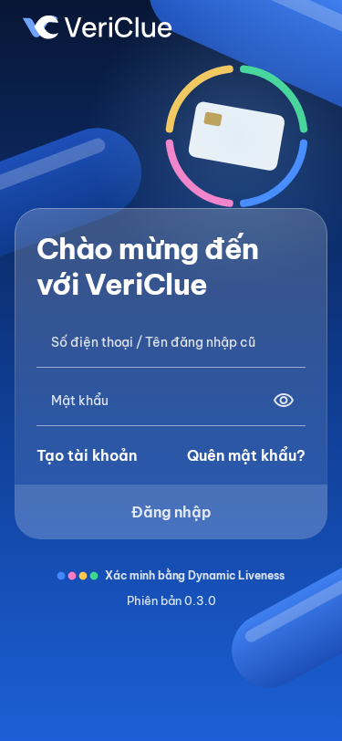
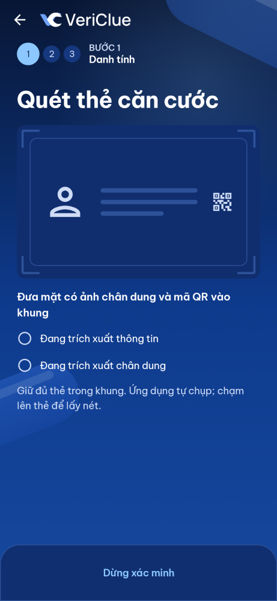
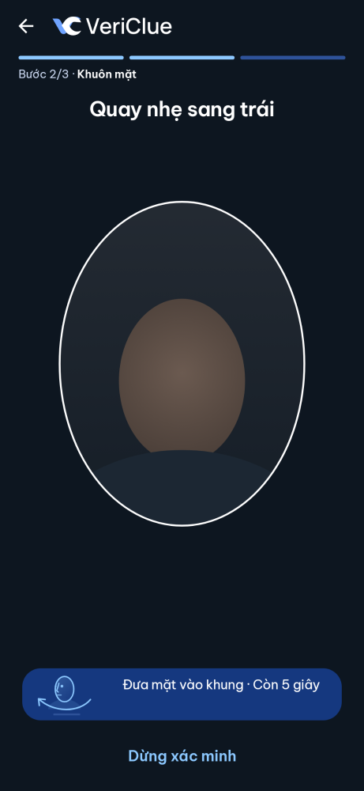
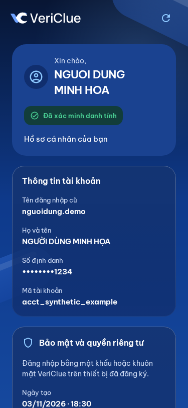
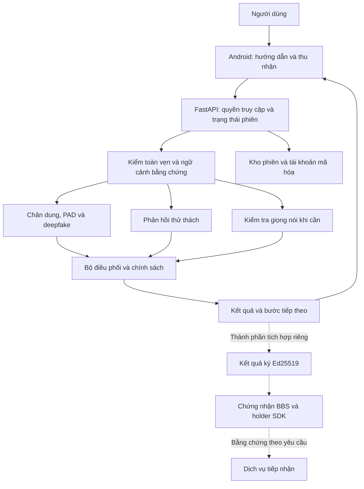

<div align="center">

# VeriClue

**Xác minh tin cậy. Chia sẻ chủ động.**

Nền tảng xác minh danh tính đa phương thức, bảo vệ bằng chứng theo phiên
và hỗ trợ chia sẻ thông tin có chọn lọc.

**Android · FastAPI · Face & Voice AI · Cryptographic Proofs**

[Ứng dụng](#trải-nghiệm-ứng-dụng) · [Thiết kế](#thiết-kế-hệ-thống) · [Bảo mật](#mô-hình-bảo-vệ) · [Tích hợp](#tích-hợp-và-bằng-chứng-riêng-tư) · [Phát triển](#bắt-đầu-phát-triển)

</div>

## Từ một lượt xác minh đến một bằng chứng có thể kiểm tra

Một dịch vụ số cần biết ai đang thao tác, dữ liệu được cung cấp có đáng tin
hay không và kết quả có thể được sử dụng trong phạm vi nào. VeriClue tổ chức
các yêu cầu đó thành một quy trình: **thu nhận có hướng dẫn, phân tích đa lớp,
kiểm soát bằng chứng và quản lý quyền truy cập**.

Trên điện thoại, người dùng đăng ký, xác minh và truy cập lại tài khoản.
Ở phía máy chủ, mỗi bước gắn với trạng thái phiên, thử thách và chính sách
quyết định. Các thành phần mật mã bổ sung khả năng kiểm tra tính toàn vẹn,
nguồn cấp và ngữ cảnh sử dụng bằng chứng.

Dự án do **DS@AInSec4E** phát triển cho **Data for Life 2026**, đề bài
**BTL86-16**. Ngân hàng, ví điện tử, chứng khoán và dịch vụ công là các nhóm
ứng dụng mục tiêu; không hàm ý đã có quan hệ đối tác hoặc triển khai thực tế.

## Trải nghiệm ứng dụng

<table>
  <tr>
    <th>Đăng nhập và khôi phục</th>
    <th>Thu nhận căn cước</th>
    <th>Thử thách khuôn mặt</th>
    <th>Hồ sơ tài khoản</th>
  </tr>
  <tr>
    <td></td>
    <td></td>
    <td></td>
    <td></td>
  </tr>
</table>

<p align="center"><sub>Snapshot Compose ngày 04/11/2026, dữ liệu minh họa.
<a href="docs/assets/app/README.md">Nguồn ảnh và phiên bản</a>.
Giao diện có thể thay đổi theo bản build.</sub></p>

**Một tài khoản, các bước xác minh có ngữ cảnh.** Người dùng xem mục đích xử lý
dữ liệu, bắt đầu đăng ký bằng số điện thoại, quét căn cước và kiểm tra thông
tin được trích xuất. Tiếp theo, ứng dụng hướng dẫn thu hình và thực hiện thử
thách của phiên. Nhánh giọng nói cung cấp kiểm tra bổ sung khi luồng yêu cầu.

Sau xác minh, người dùng thiết lập mật khẩu, đăng nhập lại bằng mật khẩu hoặc
camera VeriClue và xem hồ sơ. Luồng khôi phục quản lý việc lấy lại quyền truy
cập theo các điều kiện của backend. Đây là camera và mô hình của VeriClue,
khác với sinh trắc hệ điều hành như Face ID của iOS.

[Build và cài Android](apps/android/README.md) ·
[Ứng dụng iOS và quy trình riêng](apps/ios/README.md)

## Thiết kế hệ thống

VeriClue phân chia rõ trách nhiệm: **ứng dụng thu nhận, server kiểm chứng,
bộ điều phối áp dụng chính sách**. Một kết quả từ client hoặc một mô-đun
riêng lẻ không tự cấp quyền hoàn tất toàn bộ quy trình.



Đường nét đứt mô tả nhánh bằng chứng được triển khai riêng; **ví Android và
chuỗi đăng nhập kết hợp BBS chưa nối hoàn chỉnh**. Khả năng hoạt động của mỗi
nhánh phụ thuộc profile, cấu hình và nguồn kết quả đủ điều kiện.

### Phân tích đa phương thức

| Thành phần | Vai trò trong quyết định |
|---|---|
| **Chất lượng đầu vào** | Kiểm điều kiện phân tích trước khi diễn giải nội dung |
| **SCRFD và LVFace** | Phát hiện khuôn mặt, đối chiếu chân dung tham chiếu và tính nhất quán |
| **FS-VFM PAD** | Phân tích dấu hiệu tấn công trình diễn, như ảnh hoặc màn hình phát lại |
| **GenD CLIP** | Phân tích dấu hiệu khuôn mặt được tạo/chỉnh sửa bằng AI |
| **Thử thách theo phiên** | Đối chiếu chuyển động đầu và ánh mắt với yêu cầu; ánh sáng là tín hiệu phụ |
| **Giọng nói** | Kiểm nội dung câu đọc, dấu hiệu giả mạo âm thanh và đồng bộ môi–âm thanh theo cấu hình |
| **Bộ điều phối** | Kết hợp kết quả theo chính sách, quản lý nhánh tiếp theo và trạng thái lỗi |

**Giá trị tích hợp của VeriClue** là đưa các năng lực trên vào cùng vòng đời:
đúng dữ liệu, đúng thử thách, đúng tài khoản và đúng quyền truy cập. Chất lượng
phân tích và độ tin cậy của giao thức được kiểm tra riêng; benchmark mô hình
không được cộng gộp thành “độ chính xác VeriClue”.

[Kiến trúc kỹ thuật](docs/architecture/architecture.md) ·
[Hợp đồng dữ liệu](packages/contracts/schemas/) · [Gói ML](ml/README.md)

## Mô hình bảo vệ

Bảo mật được tổ chức theo những gì cần kiểm chứng ở mỗi chặng của dữ liệu.

### 1. Dữ liệu có thuộc đúng lượt xác minh?

Android dùng **ECDSA P-256** qua **Keystore** để ký bản mô tả media, gồm hash
SHA-256, thông tin phiên và thử thách. Server tính lại hash từ byte nhận được,
kiểm chữ ký rồi kiểm trạng thái sử dụng nonce. Cơ chế này xử lý việc sửa dữ
liệu, dùng sai ngữ cảnh và phát lại bằng chứng giao thức.

Thử thách thiết bị **L0** kiểm quyền sử dụng khóa đã đăng ký. Chữ ký và L0
không thay kiểm tra nội dung, không chứng minh camera thật và không mặc nhiên
là attestation phần cứng hoặc Passkey.

[Chữ ký media](docs/architecture/media-proof.md) ·
[Xác thực thiết bị và tài khoản](docs/architecture/account-authentication.md)

### 2. Ai được gửi và xử lý dữ liệu?

API kiểm quyền **trước parser**, kiểm lại sau khi nhận body và áp các giới
hạn upload. Allowlist vai trò tệp/field, kiểm nội dung ảnh, trần dung lượng và
quota giảm đầu vào không hợp lệ. Quyết định quan trọng thuộc server; lỗi hoặc
trạng thái suy giảm ở kiểm tra bắt buộc không được coi là đạt.

[Tiếp nhận phiên](docs/architecture/session-ingress.md) ·
[An toàn ảnh tải lên](docs/architecture/upload-image-safety.md)

### 3. Thông tin được giữ và tra cứu thế nào?

Khi bật chế độ riêng tư, payload nhạy cảm và media dùng **AES-256-GCM**.
Khóa dữ liệu riêng theo phiên/tài khoản được bọc bởi khóa chủ; ngữ cảnh AAD
ràng buộc ciphertext với đối tượng tương ứng. **HMAC** phục vụ tra cứu định
danh. Công cụ bảo trì hỗ trợ bọc lại khóa dữ liệu khi đổi master key.

Server giải mã phần dữ liệu cần thiết để chạy mô hình; không phải mã hóa đầu
cuối hoặc mã hóa mọi cột DB. Retention và hủy khóa áp dụng theo phạm vi, không
mặc nhiên xóa toàn bộ bản sao lưu hay chứng nhận đã cấp.

[Kho riêng tư](docs/architecture/session-privacy.md) ·
[Vòng đời khóa](docs/runbooks/master-key-lifecycle.md)

### 4. Quyền truy cập tài khoản được kiểm soát ra sao?

Mật khẩu dùng **PBKDF2-HMAC-SHA256 với salt ngẫu nhiên**, kèm giới hạn thử sai.
Token truy cập có hạn, chỉ lưu hash ở server và có thể thu hồi. Dữ liệu ghi
nhớ trên Android được mã hóa, app tắt backup. Biên nhận đồng ý, quyền theo
phạm vi và nhật ký thao tác hỗ trợ quản lý vòng đời dữ liệu.

[API tài khoản](services/api/README.md) ·
[Đồng ý sử dụng dữ liệu](docs/architecture/session-privacy-consent.md)

## Tích hợp và bằng chứng riêng tư

VeriClue được thiết kế cho hai nhu cầu bổ sung cho nhau:

| Nhu cầu | Vai trò của VeriClue | Trách nhiệm bên tiếp nhận |
|---|---|---|
| **Thực hiện xác minh** | Quản lý phiên, phân tích, cung cấp kết quả qua các thành phần API | Chấp nhận nguồn xác minh, lập hồ sơ, quyết định cấp quyền |
| **Kiểm chứng bằng chứng đã cấp** | Thành phần ký kết quả Ed25519, issuer/verifier BBS và holder SDK | Kiểm nguồn cấp, yêu cầu, thời hạn và liên kết đúng tài khoản |

**Ví dụ:** khi đăng ký lần đầu, một dịch vụ vẫn nhận các thông tin cần thiết
để biết khách hàng là ai. Khi đã liên kết tài khoản, bằng chứng phù hợp có thể
giảm việc truyền lại toàn bộ hồ sơ. Bên nhận luôn có quyền yêu cầu xác minh
bổ sung; chia sẻ có chọn lọc không loại bỏ thông tin bắt buộc.

**BBS** cho phép tạo bằng chứng mới về những thuộc tính được chọn từ chứng
nhận đã ký. Nó không tự xác minh người thật hoặc thay chính sách của bên nhận.
Repo có triển khai mật mã Node.js, holder SDK trình duyệt và kiểm thử bằng
dữ liệu tổng hợp; phần ví Android và hành trình liên dịch vụ cần tích hợp tiếp.

[Dịch vụ chứng nhận](services/credentials/README.md) ·
[Holder SDK](docs/architecture/private-credential-holder.md) ·
[Verifier](docs/architecture/private-credential-verifier.md) ·
[Kết quả ký](docs/architecture/signed-session-results.md)

## Bắt đầu phát triển

### Cài workspace

Cần **Git, uv và Python 3.12**. Android dùng **JDK 17/Android SDK**, iOS cần
**macOS/Xcode**. Node và Docker tùy thành phần; xem README tương ứng.

```powershell
# Tại thư mục gốc repo
uv sync --frozen --all-packages
uv run pre-commit install
uv run pytest
uv run ruff check .
uv run ruff format --check .
uv run python scripts/plan_check.py
```

Script tổng hợp: `./scripts/setup.ps1` hoặc `bash scripts/setup.sh`.
`uv sync` không tự cung cấp toàn bộ trọng số hay cấu hình triển khai.

| Bạn muốn… | Bắt đầu tại |
|---|---|
| Build ứng dụng | [Android](apps/android/README.md), [iOS](apps/ios/README.md) |
| Chạy backend và migration | [API](services/api/README.md), [dev setup](docs/runbooks/dev-setup.md) |
| Tải/chạy mô hình | [ML](ml/README.md), [manifest](models/manifest.yaml) |
| Thử mật mã BBS riêng | [Credentials](services/credentials/README.md) |
| Chuẩn bị môi trường bảo vệ | [Protected profile](docs/runbooks/protected-profile.md) |
| Tham gia phát triển | [CONTRIBUTING](CONTRIBUTING.md), [AGENTS](AGENTS.md) |

<details>
<summary><strong>Launcher cho runtime local đã cấu hình</strong></summary>

Dùng Python environment đã cài phụ thuộc runtime, từ gốc repo:

```powershell
python scripts/server.py status --runtime-dir <runtime-directory>
python scripts/server.py start --runtime-dir <runtime-directory>
python scripts/server.py stop --runtime-dir <runtime-directory>
```

API cổng **8421**, health endpoint **`/healthz`**. Cần cấu hình, DB migration và
model hợp lệ từ trước. Không sao chép DB/khóa cá nhân để tạo môi trường mới.

</details>

### Bản đồ mã nguồn

```text
apps/android/          Kotlin và Jetpack Compose
apps/ios/              Ứng dụng iOS, build và nghiệm thu riêng
apps/web/              Next.js và công cụ lab
services/api/          FastAPI, phiên, tài khoản, điều phối
services/credentials/  BBS, issuer/verifier và holder SDK
ml/                    Face, presence, voice, router, eval, mock
packages/contracts/    Schema và vector kiểm thử giao tiếp
scripts/               Cài đặt, kiểm thử và vận hành
docs/                  Kiến trúc, runbook, kế hoạch và bàn giao
third_party/           Nguồn và giấy phép thành phần kế thừa
```

## Cấu hình, đánh giá và khả năng triển khai

Repo chứa **hành trình ứng dụng**, **thành phần nghiên cứu** và **công cụ tích
hợp riêng**. Khả năng đang bật phải được xác nhận theo source, build và profile.
Test hợp đồng/mật mã, benchmark paper và đánh giá sinh trắc toàn hệ thống
cung cấp các loại bằng chứng khác nhau; `/healthz` trả `ok` không thay chúng.

<details>
<summary><strong>Phạm vi cần xác nhận trước khi nghiệm thu</strong></summary>

- **Ổn định:** đã ghi nhận độ trễ biến động/timeout; kiểm lại trên runtime và
  thiết bị mục tiêu trước khi cam kết thời gian xử lý.
- **Hiệu chỉnh:** ngưỡng manual demo chưa phải bộ ngưỡng có bảo đảm thống kê.
  Xem [hiệu chỉnh phiên](docs/runbooks/session-face-calibration.md) và
  [LTT offline](docs/runbooks/offline-ltt.md).
- **Cấu hình:** OTP có thể mô phỏng; consent, retention, model, ký kết quả
  và BBS có điều kiện bật riêng. Mock phục vụ phát triển, không cấp xác minh thật.
- **Hiện diện:** ChromaPulse là tín hiệu phụ/chẩn đoán; chuyển động đầu không
  phải phép đo chiều sâu 3D.
- **Phạm vi sản phẩm:** `PRODUCT_MODE=ekyc` ẩn review/forensic. Các công cụ
  lịch sử còn trong repo không phải trọng tâm app người dân.
- **Trình bày:** người dân không thấy điểm AI hay nhãn “giả mạo”; hạn chế và
  số liệu phải đúng nguồn, phiên bản và phạm vi đã đo.

</details>

[Tài liệu](docs/README.md) · [Backlog](docs/plan/backlog.md) ·
[Bàn giao](docs/status/handoffs/) · [STATUS](docs/status/STATUS.md)

Một số tài liệu giữ mốc lịch sử; đối chiếu ngày, code và bàn giao trước khi
dùng để xác nhận thiết kế hoặc cấu hình hiện tại.

## Quyền sử dụng

**Phần thuộc nhóm được bảo lưu mọi quyền theo [LICENSE](LICENSE).** Repo không
cấp giấy phép nguồn mở cho phần đó. Thành phần upstream, trọng số và dữ liệu
có điều khoản riêng, có thể giới hạn nghiên cứu hoặc phi thương mại.

Trước khi tải, sử dụng hoặc phân phối, kiểm [third_party](third_party/README.md),
[manifest](models/manifest.yaml) và điều khoản nguồn. Không commit dữ liệu
định danh/sinh trắc thật, bản ghi, DB, `.env` hoặc khóa riêng. Ảnh README dùng
snapshot tổng hợp có [nguồn và checksum](docs/assets/app/provenance.json).
