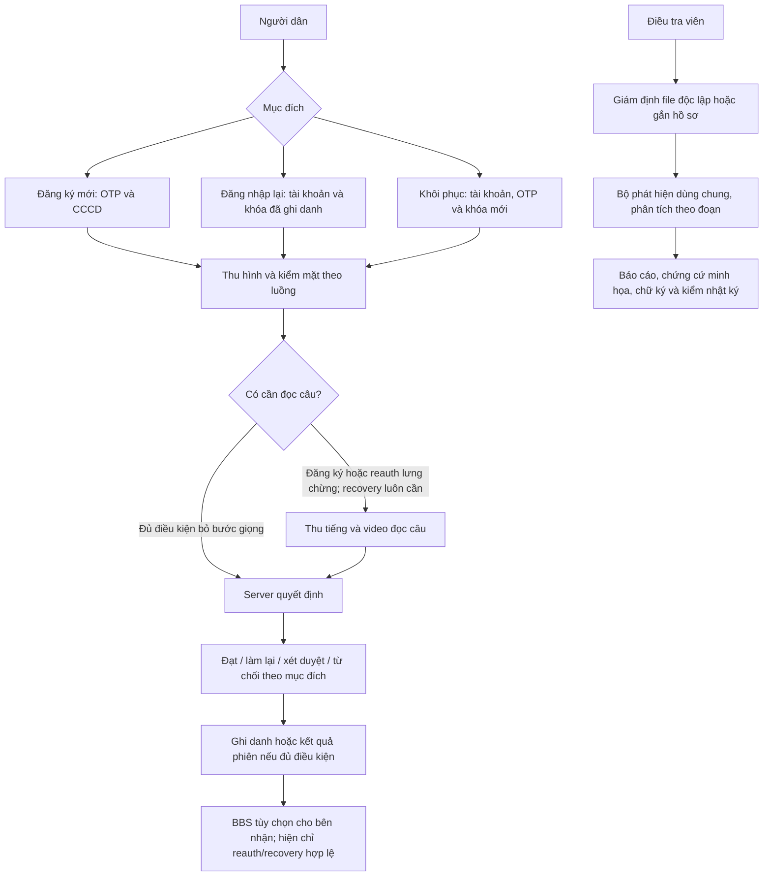

# Workflow VeriClue — cơ sở để thống nhất và rút gọn luồng

Đối chiếu main `24895c3` và phần đóng gói BBS tiếp theo, ngày 28/10/2026.
Tài liệu mô tả hệ thống làm gì ở từng bước; chưa thay đổi quy trình hay UI.
Nguồn ưu tiên: code/API hiện hành và cập nhật 26/10 của ADR-0016, không dùng
thứ tự cũ trong các bản proposal lưu trữ. BBS được chọn theo ADR-0018.

**Cần phân biệt:** sơ đồ dưới là luồng nghiệp vụ đích của dự án. Backend có
các module/điểm nối và nhiều test, nhưng luồng động thật, đặc biệt phiên gắn
tài khoản, còn bị `flow_unavailable` chặn trước khi đủ nghiệm thu. Không có
cờ runtime hoặc endpoint để biến mock thành một quyết định thật hợp lệ.
Thử nghiệm BBS HTTP dùng fixture quyết định ở server, không phải người thật đã
đi qua toàn bộ quy trình. App iOS/Android do nhóm tích hợp/kiểm trên máy thật.

## 1. Bức tranh toàn dự án

BBS đứng sau kết quả nguồn đủ điều kiện, không thay camera/AI/so danh tính.
Đăng ký mới hiện nhận biên nhận tài khoản, không tự chạy thêm BBS hoặc thêm
một lượt reauth. Nếu muốn cấp BBS trực tiếp sau onboarding, nhóm phải chốt
một thay đổi nguồn/hợp đồng riêng; code hiện tại chưa hỗ trợ đường đó.

## 2. Đăng ký mới — người dùng và hệ thống làm gì?

| Bước | Người dùng / ứng dụng | Server / AI thực hiện | Đầu ra và nhánh tiếp theo |
|---|---|---|---|
| 1. Bắt đầu và đồng ý | Đọc phạm vi xử lý, chọn đồng ý cần thiết; app chuẩn bị khóa thiết bị và mở phiên | Tạo mã phiên/bearer có hạn; ghi purpose, nonce, ngữ cảnh; cấp thử thách/mã lượt do server sinh | Có phiên hợp lệ. Chưa coi khóa mới hoặc lời tự khai là danh tính đã xác thực |
| 2. Xác minh số điện thoại | Nhập số và OTP | Kiểm OTP đúng, còn hạn, chưa dùng, chưa vượt số lần sai; lưu phone HMAC theo chính sách | Đúng mới đi tiếp. **Kênh SMS hiện là mô phỏng**, không gọi đó là SMS thật |
| 3. Chụp CCCD | Chụp hai mặt bằng camera sau; app hướng dẫn nét/lóa | Đọc QR/thông tin qua bộ đọc hiện có, kiểm định dạng, trích ảnh chân dung tham chiếu, kiểm trùng bằng HMAC | Trả trường thông tin để xác nhận hoặc yêu cầu chụp lại; không đọc chip/NFC hoặc chứng minh thẻ thật |
| 4. Xác nhận thông tin | Xem và xác nhận; nếu sửa thì gửi giá trị đã sửa | Kiểm đủ trường và trạng thái; lưu bản xác nhận. Sửa khác QR có thể tạo dấu hiệu cho bàn duyệt | Có ảnh/thông tin tham chiếu đã chốt; chưa phải pass sinh trắc |
| 5. Căn mặt vào khung | Chuyển sang camera trước; làm theo một chỉ dẫn chất lượng mỗi lần | App kiểm chất lượng để hướng dẫn, server kiểm lại từ media; làm mới lượt thử thách đúng lúc nếu cần | Đủ chất lượng mới thu lượt cần chấm. Phép đo trên điện thoại không tự quyết đạt |
| 6. Giữ đầu yên, nhìn theo chấm | Một phiên quay liền mạch; app chụp chính diện ở nền trung tính, phát màu rồi cho chấm chạy theo gói server | Từ video: đo phản xạ ánh sáng theo màu/thời gian, chuyển động mắt so với đường chấm, kiểm nguồn camera/CamProbe theo khả năng hiện có | Bằng chứng hiện diện cho lượt này; thiếu/lỗi module bắt buộc không được mặc nhiên coi đạt |
| 7. Quay đầu theo lệnh | Quay trái/phải theo thứ tự ngẫu nhiên rồi trở về giữa; không cần người dùng tự chụp thêm từng ảnh | Đo pose/thứ tự/độ phủ; lấy khung chính diện/nghiêng để PAD/GenD và kiểm liên tục danh tính theo protocol | Có khung đủ góc/cùng người hoặc yêu cầu làm lại/chuyển duyệt. **Pose đúng chưa chứng minh chiều sâu 3D** |
| 8. Chốt phần mặt | App gửi media đã ký cùng mã lượt; có thể thể hiện đang xử lý | Kiểm bearer, hash/chữ ký thiết bị, nonce/challenge/hạn/chống dùng lại; chạy chất lượng, PAD, GenD, ánh sáng, mắt/đầu và so mặt với tham chiếu theo cấu hình | Server phối hợp các cổng và policy; phân biệt lỗi chất lượng, nghi ngờ và lỗi kỹ thuật |
| 9. Đọc câu khi được yêu cầu | **Chỉ đọc nếu mặt lưng chừng hoặc phiên còn nợ bước giọng**; app thu WAV và video cùng lượt | Kiểm đúng câu (ASR), nhịp/độ phủ giọng (alignment/timing), giọng AI, khớp khẩu hình–tiếng, cùng người giữa video mặt và video đọc; kiểm chữ ký/nonce media | Đủ điều kiện mới có thể pass. Reread cấp câu/mã mới; không dùng lại kết quả cũ |
| 10. Quyết định và ghi danh | Nhận thông báo phù hợp, không thấy điểm hoặc chữ “giả mạo” | Mọi cổng bắt buộc đạt mới ghi quyết định. Khi đủ điều kiện và bật ghi danh, trích/lưu mẫu mặt mã hóa, gắn public key đã dùng và tạo tài khoản trong transaction | Trả account/device receipt. Lỗi ghi danh rollback, không trả thành công dở dang. Bản demo tài khoản có TTL theo cấu hình/quy tắc lưu trữ |

**Điểm quan trọng về so mặt:** ảnh CCCD là tham chiếu chính diện. Protocol
so CCCD dùng ảnh/khung chính diện phù hợp; kiểm các góc quay thuộc phần liên tục
danh tính/liveness. Không đưa cả ba ảnh nghiêng vào so CCCD rồi gọi đó là ba lần
xác minh giấy tờ. Backend hiện chọn LVFace theo config; không dùng tên AdaFace cũ
trong ADR như bằng chứng model đó đang chạy ở mọi đường.

**Quy tắc rẽ nhánh đăng ký đã chốt 26/10:**

- Mặt rõ và mọi cổng bắt buộc đạt → bỏ đọc câu, chốt/ghi danh khi đủ điều kiện.
- Mặt lưng chừng → yêu cầu đọc câu. Khi một phiên đã nợ bước giọng, làm lại mặt
  không tự xóa nghĩa vụ đó.
- Nghi rõ hoặc cổng an ninh bắt buộc lỗi → chuyển duyệt theo policy; không tự pass.
- Chất lượng chưa đủ → retry trong giới hạn, thử thách/nonce mới và bỏ bằng chứng
  cũ. Hết lượt → nhánh xét duyệt phù hợp.

Số giây “giữ yên/quay đầu/đọc câu” phải lấy từ protocol/cấu hình của lượt. Các
ước lượng trải nghiệm trong tài liệu thiết kế **chưa là số đo người dùng thật**.
Không thêm một màn cho mỗi detector: nhiều detector đọc chung một video.

## 3. Đăng nhập lại — tái sử dụng danh tính đã ghi danh

| Bước | Người dùng / ứng dụng | Hệ thống thực hiện |
|---|---|---|
| 1. Chọn tài khoản/thiết bị | App dùng receipt đã lưu và nonce của yêu cầu mới | Kiểm tài khoản/thiết bị còn hiệu lực; không tin public key mới do client tự gửi để thay khóa cũ |
| 2. Chứng minh giữ khóa (L0) | App ký challenge bằng private key đã ghi danh | Kiểm P-256, nội dung challenge, phiên, hạn và dùng một lần. L0 ACK **không phải** quyết định pass sinh trắc hoặc credential nguồn |
| 3. Kiểm mặt theo luồng | Thu hình ngắn theo yêu cầu; không chụp CCCD/OTP lại trong luồng bình thường | Chất lượng, PAD/GenD và so với **mẫu tài khoản**, cùng các cổng cần thiết của policy. Reauth không mặc định đầy đủ thử thách động như onboarding/recovery |
| 4. Leo thang nếu cần | Đọc câu khi mặt lưng chừng | Kiểm giọng, nội dung và liên tục danh tính; bắt buộc không được bỏ khi đã yêu cầu |
| 5. Kết quả | Nhận thành công/không thành công hoặc hướng dẫn khôi phục | Trả pass/deny/recovery_required theo điều kiện. Reauth không mặc định chuyển nhân viên duyệt. Kết quả ký gắn nonce/purpose/audience và hạn ngắn khi đủ điều kiện |

Đây là thiết kế đích; code hiện giữ guard `flow_unavailable` với bước sinh trắc
phiên account-bound. L0 có thể kiểm độc lập, nhưng không được bỏ guard đó hoặc
nhận pass client để hoàn thành demo BBS. Cần kiểm module/policy/thiết bị thật trước.

## 4. Khôi phục hoặc đổi thiết bị

| Bước | Người dùng / ứng dụng | Hệ thống thực hiện |
|---|---|---|
| 1. Xác minh quyền khôi phục | Chọn tài khoản, OTP tới số đã đăng ký; app có khóa mới | Kiểm binding tài khoản/số điện thoại, OTP/hạn/số lần; khóa mới chưa được tin ngay |
| 2. Kiểm mặt đầy đủ | Căn mặt, ánh sáng/mắt/quay đầu theo gói server | Kiểm hiện diện, PAD/GenD và so với **mẫu đã ghi danh**, không thay mốc bằng CCCD mới tự cung cấp |
| 3. Luôn đọc câu | Thu tiếng/video câu ngẫu nhiên | Kiểm đúng câu, giọng AI, nhịp/khẩu hình và cùng người giữa các đoạn; chữ ký/nonce/hạn đầy đủ |
| 4. Đổi khóa khi đạt | Nhận kết quả | Transaction gắn khóa mới, mã hóa lại binding cần thiết, thu hồi phiên/khóa cũ theo logic tài khoản; nghi thì xét duyệt. Không đổi khóa nếu kiểm chưa đạt |

Nguồn thực tế còn guard như phần reauth. Kiểm thử lịch sử tổng hợp không thay
được nghiệm thu người dùng/thiết bị. Bên tích hợp tự quyết chính sách nghiệp vụ
sau khôi phục; VeriClue không tự đặt hạn mức giao dịch hoặc quy tắc ngân hàng.

## 5. BBS — chia sẻ kết quả tối thiểu sau xác minh

| Bước | Ai làm | Hệ thống làm gì / dữ liệu đi đâu |
|---|---|---|
| 1. Chọn chia sẻ | Người dùng/app | Chỉ dùng kết quả reauth/recovery đã commit, được Ed25519 ký và đủ mọi cổng; không nhận pass hoặc claim tự khai |
| 2. Đồng ý cấp | Người dùng | App nhận đồng ý riêng, SDK kiểm nguồn/pin/context, tạo secret RAM và commitment. Server **không nhận holder secret** |
| 3. Xin nội dung chấp thuận | SDK → issuer API | Server kiểm nguồn/tài khoản/khóa hiện hành rồi trả đúng byte authorization gắn phiên/result/account/device/offer hash/key/hạn/consent |
| 4. Ký và cấp | Khóa thiết bị → issuer | SDK kiểm authorization khớp trước khi gọi khóa P-256 ký. Server kiểm chữ ký, cấp BBS, giữ cache mã hóa/idempotency. SDK kiểm blind signature trước khi giữ |
| 5. Bên nhận ra challenge | Server dịch vụ nhận | Token riêng xác định origin HTTPS; server sinh nonce/policy/hạn và lưu DB. Token không nằm trong app hoặc proof |
| 6. Đồng ý xuất trình | Người dùng/app | Hiển thị đúng bên nhận và thông tin sẽ lộ; SDK tạo proof cho origin đã đồng ý. Không gửi credential/signature/secret nguyên gốc cho bên nhận |
| 7. Kiểm proof | Server bên nhận → verifier API | Kiểm trust key, proof, claim, nonce, audience và hạn; tiêu thụ challenge và commit trước valid=true. Replay bị từ chối |
| 8. Kết thúc / thử lại | App | Logout gọi destroy; timeout không tự pass. Mất phản hồi cấp thì thử lại cùng offer/body; reload mất ví. Hạn credential không vượt nguồn |

Bên nhận thấy: protocol, issuer, assurance, đã hoàn thành xác minh, khoảng hiệu
lực, policy version và bí danh theo origin. Không thấy account/device/source
result/purpose trong proof, không nhận CCCD, tên, ảnh, âm thanh hoặc điểm AI.
Bí danh ổn định theo credential trong một origin, khác khi origin đổi; không
phải mã người dùng suốt đời. Metadata/IP/claim chung vẫn có thể liên kết.

Profile tích hợp **chưa chứng minh “trên 18 tuổi”**. Bản lab có boolean tuổi tổng
hợp để so sánh BBS/SD-JWT/JWT, không phải tuổi được xác thực từ CCCD hay range proof.
BBS không phải PQC hoặc cách chứng minh video không cần rời điện thoại.

## 6. Bàn duyệt khi luồng cần nhân viên

| Bước | Nhân viên | Hệ thống |
|---|---|---|
| 1. Mở hồ sơ | Dùng credential nhân viên riêng | Kiểm quyền; cấp metadata/bằng chứng theo vai trò, che thông tin định danh mặc định |
| 2. Đọc và kiểm chứng | Xem kết quả từng module, media và lý do | Giữ snapshot; mở thông tin đầy đủ là thao tác rõ ràng có ghi truy cập; người dân không thấy điểm/lý do an ninh |
| 3. Quyết định | Chọn lý do/ghi chú theo yêu cầu | Kiểm mã lý do, phiên/trạng thái/cạnh tranh; ghi sự kiện vào chuỗi nhật ký, không cập nhật đè lịch sử |

Nhân viên duyệt không tự biến hồ sơ thành nguồn BBS: SignedResult/BBS hiện loại
phiên qua review hoặc override theo chính sách nguồn. Cần thay policy riêng nếu
nhóm muốn hỗ trợ loại chứng nhận đó trong tương lai.

## 7. Giám định file cho điều tra viên

| Bước | Điều tra viên | Hệ thống |
|---|---|---|
| 1. Gửi vật chứng | Upload video/âm thanh; tùy chọn gắn hồ sơ eKYC | Kiểm staff token, loại/dung lượng file; băm byte gốc; nếu gắn hồ sơ thì đối chiếu điều kiện và byte nguồn |
| 2. Phân tích | Theo dõi tiến độ | Chia đoạn, chạy bộ phát hiện chung; phân tích mặt/giọng theo dữ liệu có; quét provenance AudioSeal/C2PA khi runtime hỗ trợ |
| 3. Xem kết quả | Xem timeline/đoạn nghi vấn và giới hạn | Trả kết quả theo đoạn/module và trạng thái thiếu/lỗi rõ ràng. Thủy vân/manifest vắng không tự chứng minh nội dung giả |
| 4. Xuất báo cáo | Chọn báo cáo/gói xuất | Tạo HTML hoặc PDF/JSON theo runtime; minh họa khung/phổ khi bật; ràng buộc hash và ký Ed25519, không biến heatmap thành chứng minh AI đúng |
| 5. Kiểm lại | Bên nhận kiểm gói/báo cáo | Kiểm chữ ký/hash đúng byte; nếu liên kết review thì kiểm checkpoint nhật ký nguồn. Sửa byte hoặc cắt đuôi đã neo không được coi nguyên vẹn |

Đây là chế độ điều tra viên, không chèn thêm bước vào đăng ký của người dân.
Không phải báo cáo LR/ENFSI đã được hiệu chuẩn hoặc kết luận pháp lý tự động.

## 8. Các việc chạy phía sau, không nên thành màn riêng

- **Khóa và chống replay:** bearer phiên, key/challenge/nonce/hash/media signature,
  slot/timeout/quota được server kiểm; app không phải yêu cầu người dùng “ký số”
  thủ công từng detector. Không gọi ECDSA/Keystore hiện có là Passkey/FIDO2.
- **Bảo vệ dữ liệu:** AES-GCM, khóa phiên riêng, mẫu mặt mã hóa; CCCD/số điện thoại
  tra cứu bằng HMAC; audit truy cập và quyết định. BBS không thay mã hóa lưu trữ.
- **Lưu/xóa:** tài khoản demo, raw media, hồ sơ review và forensic có vòng đời
  khác nhau theo cấu hình; không tuyên bố “tất cả tự xóa sau 24 giờ”. Giám định
  chưa có TTL mặc định thì phải nói rõ cho operator. Hủy khóa không bảo đảm xóa
  mọi bản sao/bản rõ/backup ở ngoài phạm vi kiểm soát.
- **Lỗi hoặc thiếu module:** không mặc nhiên pass. UI phản hồi chất lượng hoặc
  trạng thái chung; nhân viên có thông tin kỹ thuật theo quyền riêng.

## 9. Cơ sở thảo luận rút gọn cho new user — chưa thay quy trình

Mục tiêu là giảm số thao tác/màn chờ mà vẫn biết mỗi yêu cầu đã được kiểm ở đâu.
Các điểm nhóm nên chốt sau khi đọc workflow:

1. Có thể tổ chức thành các chặng dễ hiểu **đồng ý → số điện thoại → CCCD → một
   phiên camera trước → kết quả**; giữ đọc câu là nhánh điều kiện của onboarding.
2. Không yêu cầu người dùng tự chụp ba ảnh mặt, làm riêng từng detector, xác nhận
   cùng thông tin nhiều lần hoặc làm thêm reauth/BBS chỉ để kết thúc đăng ký.
3. Căn mặt/quality là hướng dẫn trước và trong lúc thu, không thêm một màn kiểm
   tra chất lượng độc lập. Phản hồi ngay khi đủ dữ liệu; các phép tính dùng chung
   video/khung được phối hợp ở server, không thu lại media vì mỗi module một file.
4. Tải/chấm song song ở nơi code/runtime thực sự hỗ trợ; trước khi bỏ màn chờ cần
   xác định thứ tự bắt buộc, quyền hủy và trường hợp server yêu cầu giọng. Không
   quay lại quy tắc cũ “onboarding luôn đọc câu” khi thiết kế hiện tại đã bỏ.
5. Chốt riêng loại consent nào cần trước thu sinh trắc, loại lưu mẫu/dữ liệu nào
   tùy chọn và consent nào thuộc BBS/bên nhận. Không gộp thành một dấu tick tự chọn.
6. Với iOS/Android, đi qua từng màn hiện có để đối chiếu bảng trên, đo số thao tác/
   thời gian thực rồi mới thống nhất cách gộp. Hiện chưa có số đo để khẳng định
   giảm bao nhiêu giây hoặc “mượt hơn bao nhiêu phần trăm”.

## Nguồn trong repo

- Thiết kế: [ADR-0013](../adr/0013-hai-luong-ekyc.md),
  [ADR-0016, cập nhật 26/10](../adr/0016-dynamic-liveness.md),
  [ADR-0018](../adr/0018-chung-nhan-rieng-tu-bbs.md).
- Luồng/guard: [SessionFlow](../../services/api/src/vericlue_api/services/session_flow.py),
  [router theo purpose](../../ml/src/vericlue_ml/router/flows.py),
  [giao thức tài khoản](account-authentication.md).
- Runtime/model: [models.yaml](../../ml/configs/models.yaml),
  [kiểm cùng người mặt–giọng](face-voice-continuity.md).
- BBS: [cấp](private-credential-issuance.md), [verifier](private-credential-verifier.md),
  [SDK](private-credential-holder.md), [chạy demo](../runbooks/bbs-demo.md).
- Giám định: [gói PDF/JSON](forensic-pdf-bundle.md),
  [nhật ký liên kết](forensic-review-audit.md).
