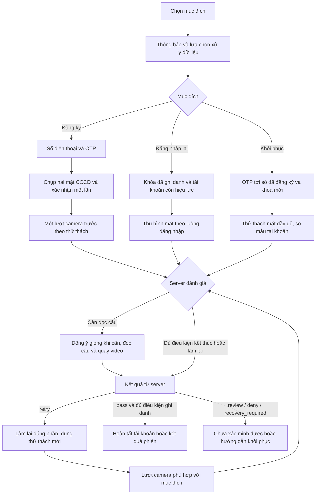

# Workflow VeriClue — đối chiếu hiện tại và đề xuất rút gọn

Đối chiếu main `54acaad` sau PR #105, ngày 28/10/2026; task FLOW-06.
**Đây là bản chuẩn bị tích hợp app, chưa thay UI hoặc chính sách API.**
Phần “đề xuất” chưa được triển khai; các cổng sinh trắc thật vẫn giữ nguyên.

## 1. Luồng tổng thể đề xuất

Đăng ký mới gồm năm chặng: **đồng ý → số điện thoại/OTP → CCCD và xác nhận →
một lượt camera trước → kết quả**. Đọc câu nằm trong chặng xác minh, chỉ xuất
hiện khi server yêu cầu. Một chặng có thể có trạng thái hướng dẫn/chờ/lỗi, không
đồng nghĩa mỗi chặng chỉ có một màn hoặc một lần bấm.

Sơ đồ là đích đề xuất. CCCD trong khôi phục đang lệch giữa Android và API,
chưa đưa thành bước bắt buộc trong sơ đồ; xem D3. BBS là nhánh chia sẻ riêng
sau nguồn kết quả hợp lệ, không thêm vào đường đăng ký thông thường.

## 2. Đăng ký mới: mỗi chặng làm gì?

| Chặng | Người dùng / app | Server / AI | Điều kiện đi tiếp |
|---|---|---|---|
| 1. Đồng ý | Đọc thông báo đúng phiên bản, chủ động chọn phạm vi; đồng ý lưu mẫu mã hóa để tạo tài khoản | Tạo phiên, cấp bearer/thử thách và ghi biên nhận trước thu dữ liệu thuộc phạm vi | Không tự tick/gọi consent thay người dùng; phiên bản đổi phải xem và đồng ý lại. Lựa chọn lưu mẫu cần được nối theo D1 |
| 2. Liên hệ | Nhập số, nhận và nhập OTP | Kiểm mã/hạn/lượt sai, lưu binding theo chính sách | Có consent `contact`; OTP hiện chỉ mô phỏng trong synthetic+mock, đường cần SMS thật chưa sẵn sàng |
| 3. CCCD | Chụp hai mặt, kiểm ảnh/thông tin trong cùng chặng, sửa nếu cần; xác nhận một lần | Kiểm byte/metadata/quota trước OCR, đọc QR/OCR, chuẩn bị chân dung tham chiếu và nhận xác nhận | Có `id_document`; `id-card/confirm` thành công trước gửi media mặt. Chưa chứng minh giấy tờ thật hoặc đọc chip |
| 4. Khuôn mặt | Căn khung; một bản ghi gồm nền trung tính, màu, chấm mắt và quay đầu theo gói server | Kiểm chữ ký trên byte gốc, mã lượt/nonce/hạn; chạy các module được cấu hình và so CCCD với khung chính diện phù hợp | Có `face_biometrics`; tín hiệu client không tự quyết đạt. Dùng chung video, không yêu cầu chụp lại cho mỗi model |
| 4b. Giọng khi cần | Chỉ khi nhận `voice_challenge`: xem phạm vi giọng, đồng ý nếu chưa có, xin micro rồi thu WAV và video đọc | Kiểm câu, nhịp/độ phủ, giọng, khớp môi và cùng người theo cấu hình; kiểm chữ ký/mã lần đọc | Có `voice_biometrics`; không thu âm chỉ vì server đã cấp sẵn prompt. Lỗi mặt bắt buộc không được giọng xóa đi |
| 5. Kết quả | Nhận thông báo phù hợp; lưu binding tài khoản khi server thực sự đã tạo | Commit quyết định; chỉ ghi danh khi đủ mọi điều kiện và được phép lưu mẫu | `pass` của phiên không tự đồng nghĩa đã tạo tài khoản. Biên nhận và khóa tương ứng phải được lưu bền trước khi hứa dùng được lần sau |

**Quy tắc mặt:**

- Mặt rõ, mọi cổng bắt buộc đạt và không còn nợ giọng → có thể kết thúc không đọc câu.
- Mặt lưng chừng hoặc còn `voice_owed` → đọc câu. Làm lại mặt không xóa nghĩa vụ giọng.
- Chất lượng chưa đủ → retry trong giới hạn, bỏ bằng chứng cũ, dùng mã lượt/nonce mới.
- Cổng an ninh bắt buộc lỗi hoặc chưa đủ căn cứ → không pass. Trong mode eKYC,
  `review` là kết thúc chưa thể xác minh, không tạo ca chờ nhân viên.

Ảnh CCCD là tham chiếu chính diện; các góc quay dùng cho hiện diện/liên tục danh
tính. Không lấy mọi ảnh nghiêng so trực tiếp với CCCD rồi gọi là ba lần kiểm thẻ.
Quay đúng hướng chưa chứng minh chiều sâu 3D. Tên model/runtime thực tế lấy từ
cấu hình và bằng chứng kết quả, không lấy tên model trong tài liệu cũ làm cam kết.

## 3. Đăng nhập lại và khôi phục

| Luồng đích | Trình tự | Tham chiếu đúng người | Lúc cần giọng |
|---|---|---|---|
| Đăng nhập lại | Tài khoản/alias đã lưu → ký challenge bằng khóa đã ghi danh (L0) → thu hình mặt → kết quả | Mẫu tài khoản; không thay bằng public key hoặc CCCD mới tự gửi | Mặt lưng chừng hoặc đã nợ giọng; nhánh lỗi/nghi rõ kết thúc theo policy |
| Khôi phục | Binding tài khoản → OTP tới số đã đăng ký và khóa mới → thử thách mặt đầy đủ → đọc câu khi đủ điều kiện → đổi binding | Mẫu đã ghi danh và binding liên hệ cũ; CCCD mới không thay thế mốc tin cậy này | Luôn phải qua bước giọng trước khi khôi phục thành công; lỗi mặt bắt buộc có thể kết thúc sớm |

Đăng nhập bình thường đề xuất đi thẳng từ lựa chọn tài khoản sang kiểm khóa/mặt,
không nhập số/OTP hoặc chụp CCCD lại. Khóa mất/tài khoản hết hạn thì sang hướng
dẫn khôi phục, không âm thầm tạo khóa thay thế rồi gọi là đăng nhập.

**Giới hạn hiện tại:** L0 có kiểm P-256 độc lập, nhưng ACK khóa chưa phải pass
sinh trắc. `SessionFlow.ensure_flow_available` vẫn chặn bước sinh trắc account-bound
(kể cả mock) và luồng động real/mixed bằng `503 flow_unavailable`. Không có bước
trong tài liệu này cho phép bỏ chốt đó. OTP thật, app và module/policy/thiết bị
còn phải nghiệm thu trước khi gọi ba luồng là chạy thật trọn vẹn.

## 4. Những gì cần sửa ở app để có luồng trên

Đối chiếu này dùng Android đã có trên main. Các PR iOS chưa merge được xem là
điểm tích hợp tương lai, không phải tính năng đã có trên main.

| Hiện tại trên main | Tác động | Phương án tích hợp |
|---|---|---|
| `TermsScreen.onAccept` chỉ điều hướng sang Phone; không truyền lựa chọn tới `LiveFlow` | Bật yêu cầu consent ở API sẽ chặn bước thu dữ liệu | Truyền lựa chọn và version, tạo phiên rồi ghi consent trước OTP/CCCD/mặt; không thêm màn đồng ý cho mỗi detector |
| Checkbox lưu mẫu mặt/lưu CCCD là tùy chọn nhưng lựa chọn chưa đi tới backend; ghi danh điều khiển bằng cấu hình server | Không thể khẳng định tùy chọn “không lưu” đã được thực thi | Theo D1: đăng ký cần đồng ý lưu mẫu, không đồng ý thì dừng tạo tài khoản. Không quy đổi consent xử lý CCCD thành lưu ảnh dài hạn |
| `AccountFlow.begin(reauth)` đi Phone; `FlowRules.afterOtp` mới bỏ CCCD | Đăng nhập lại vẫn có số/OTP dù luồng đích dựa khóa và mẫu tài khoản | Sau thông báo/lựa chọn phù hợp, tạo phiên và kiểm L0 rồi vào mặt; không mở guard sinh trắc |
| Chụp CCCD → xem ảnh → quay mặt → Confirm; app gửi mặt sau confirm | Thời gian xem/sửa thông tin có thể làm thử thách hoặc video mặt hết hạn; hiện chưa có upload mặt song song trong lúc đọc thông tin | Gộp xem ảnh/thông tin trong chặng CCCD và xác nhận trước quay mặt (D2); refresh challenge sau chặng này |
| Android recovery đi qua CCCD; `IdentitySteps.ensure_card_upload_allowed` từ chối card upload khi đã có `account_id` | Có lệch luồng trước cả nghiệm thu khôi phục thật | Chốt D3; không tự bỏ hoặc mở thêm cổng khôi phục trong PR tài liệu |
| `leave()` dừng capture và reset local, chưa gọi withdrawal | Rời app không đồng nghĩa server đã hủy phiên/xóa dữ liệu | Tách “rời luồng” với “rút đồng ý”; thêm logic hủy/biên nhận theo [bàn giao app](mobile-privacy-integration.md) |
| Nội dung consent còn nêu review 30 ngày; nhánh `Review` và nhãn demo còn “chờ duyệt” | Lệch mode eKYC không bàn duyệt và retention mới | Đổi nội dung theo profile đã triển khai; không hứa có nhân viên đang xử lý |
| `AccountFlow.finish` ghi log nếu thiếu/không lưu được receipt nhưng vẫn giữ kết quả pass | Có thể hiểu nhầm đã có tài khoản đăng nhập được trên máy | Phân biệt xác minh phiên với tạo/lưu tài khoản; chỉ hứa đăng nhập lại khi binding được lưu bền |

## 5. Quyền riêng tư, gián đoạn và BBS

**Consent theo phiên:** version/nhóm xử lý phải phù hợp với thông báo và dữ liệu
được dùng. Server kiểm trước parser và trước xử lý; dùng lại CCCD/liên hệ/giọng
cũ cũng phải có quyền hiện hành. Checkbox cấp/lộ thuộc tính BBS là lựa chọn riêng.
Backend hiện chưa có hợp đồng cho lựa chọn lưu mẫu/CCCD dài hạn trong D1.

**Rút lại:** app dừng camera/micro và upload mới, gọi withdrawal bằng bearer
hiện hành; chỉ xác nhận đã nhận yêu cầu khi có biên nhận server. Mất mạng không
được hiện “đã xóa”. Server chặn tiếp xử lý và hủy khóa riêng của phiên trước dọn
file; biên nhận phân biệt hủy khóa, xóa file và plaintext lease chưa xác nhận dọn.
Không hứa xóa mẫu tài khoản, backup hoặc thu hồi ngay BBS đã cấp.

**Gián đoạn/retry:** làm lại đúng phần còn hợp lệ, dùng challenge/token mới theo
server; không gửi lại bằng chứng cũ với mã mới. Nếu server đã ACK media/signals,
không gửi lại tùy tiện. Mất response commit là trạng thái chưa biết, cần đối
chiếu trạng thái bằng cơ chế API thực sự có; không coi transport error là rollback.
Nếu token hết hạn không gọi được withdrawal thì không báo đã xóa; cần cơ chế hỗ
trợ riêng hoặc retention. Chi tiết ở tài liệu bàn giao app.

**Retention mode eKYC:** ca đạt dùng `MEDIA_TTL_PASS_HOURS`, ca chưa đạt dùng
`MEDIA_TTL_UNVERIFIED_HOURS` (đều mặc định 24h). Tính từ `decided_at`; phiên chưa
có mốc này dùng `created_at + SESSION_MAX_SECONDS`. Polling không gia hạn.
Đây là thời hạn kho phiên, không phải lời hứa “mọi dữ liệu tự xóa sau 24h”.
Tài khoản demo có vòng đời riêng, hiện 24h theo `AccountStore`.

**BBS:** sau nguồn reauth/recovery đã commit, có chữ ký và đủ điều kiện, người
dùng chủ động chọn chia sẻ → chấp thuận cấp → khóa thiết bị ký nội dung server
cấp → holder giữ secret/credential → bên nhận sinh challenge → người dùng đồng
ý thuộc tính/bên nhận → tạo và kiểm proof một lần. Hiện không cấp trực tiếp từ
onboarding, mock/L0 hoặc pass client. Không bắt new user đăng nhập lại thêm một
lần chỉ để trình diễn BBS. SDK holder hiện có không đồng nghĩa đã nối màn app.

BBS chia sẻ kết quả tối thiểu/bí danh theo origin; không chứng minh camera thật,
không thay AES-GCM và không phải PQC. Metadata vẫn có thể liên kết. Chi tiết:
[cấp](private-credential-issuance.md), [holder](private-credential-holder.md),
[verifier](private-credential-verifier.md), [runtime](../runbooks/bbs-demo.md).

## 6. Quyết định và điểm cần thống nhất khi tích hợp

| Mã | Nội dung | Trạng thái |
|---|---|---|
| D1 | Đăng ký tài khoản cần chủ động đồng ý lưu mẫu mặt mã hóa phục vụ đăng nhập lại/khôi phục; từ chối thì dừng tạo tài khoản. Không thêm chế độ xác minh một lần trong đợt này | Đã chọn sau khi người dùng giao quyền quyết định ngày 28/10. Cần nối lựa chọn vào backend; hiện chưa có contract cho ý chí lưu mẫu, không dùng cờ cấu hình thay biên nhận |
| D2 | Xác nhận thông tin cùng chặng CCCD, trước quay mặt; chỉ bắt đầu lượt camera sau xác nhận | Đề xuất rút gọn. Chưa áp dụng điều hướng; cần nhóm app thống nhất cùng bản luồng |
| D3 | Khôi phục có yêu cầu chụp CCCD mới không? | Chưa thống nhất: UI đang có, API account-bound không nhận. Đề xuất dùng binding cũ + OTP + mẫu đã ghi danh + mặt/giọng; nếu cần CCCD bổ sung phải thiết kế cổng/API riêng, không thay tham chiếu cũ bằng ảnh mới |

D1 chỉ nói về mẫu cần cho tài khoản, không mặc nhiên cho phép lưu ảnh/video gốc
hoặc toàn bộ CCCD lâu dài. Account payload hiện có template và binding khóa,
cùng HMAC tra cứu ở metadata; kho phiên và tài khoản có khóa/vòng đời riêng.
Nội dung thông báo phải mô tả đúng những kho này và kênh yêu cầu xóa thực tế.
Không tự đặt pháp nhân hoặc kết luận tuân thủ từ một boolean.

Chưa có số đo thời gian/người dùng nên không công bố giảm bao nhiêu giây/phần trăm.

## 7. Thứ tự triển khai và nghiệm thu

1. Nhóm thống nhất D2/D3 và nội dung thông báo; bổ sung yêu cầu/hợp đồng lưu mẫu
   theo D1 trước thay đổi server/client có liên quan. Không cần thêm màn riêng
   cho mỗi loại consent hoặc detector.
2. Nối model/client API consent, lựa chọn theo phiên, version thay đổi, withdrawal
   và xử lý lỗi trong logic app; UI nối dữ liệu/hành động cần thiết. Áp dụng cùng
   hợp đồng cho iOS khi các nhánh tương ứng được tích hợp.
3. Nghiệm thu consent và luồng bằng mock có nhãn rõ, dữ liệu tổng hợp. Bật yêu
   cầu consent không biến mock thành protected hoặc mở được ghi danh thật.
4. Kiểm trên thiết bị: permission đúng lúc, capture/chữ ký, gián đoạn, mạng,
   receipt/alias, thông báo không có điểm/lý do an ninh hoặc lời hứa bàn duyệt.
5. Nghiệm thu module/policy, OTP, HTTPS/khóa/backup và đường real theo task liên
   quan trước khi xét mở guard. Không thêm cờ bỏ qua bảo vệ cho demo.

Bàn duyệt và giám định là **future work / mode tools**, không nằm trong ba luồng
mobile đang đề xuất. Mode eKYC trả 404 các route này. Các chức năng báo cáo đã
có vẫn xem ở [kiến trúc chung](architecture.md), không thêm actor nhân viên vào
workflow sản phẩm hiện tại.

## Nguồn đối chiếu

- [App/điều hướng Android](../../apps/android/app/src/main/java/vn/vericlue/app/ui/App.kt),
  [FlowRules](../../apps/android/app/src/main/java/vn/vericlue/app/flow/Flow.kt),
  [LiveFlow](../../apps/android/app/src/main/java/vn/vericlue/app/flow/LiveFlow.kt),
  [AccountFlow](../../apps/android/app/src/main/java/vn/vericlue/app/flow/AccountFlow.kt).
- [SessionFlow/guard](../../services/api/src/vericlue_api/services/session_flow.py),
  [policy theo mục đích](../../ml/src/vericlue_ml/router/flows.py),
  [CCCD](../../services/api/src/vericlue_api/services/identity_steps.py),
  [ghi danh](account-enrollment.md), [khóa/tài khoản](account-authentication.md).
- [Consent và phạm vi xóa](session-privacy-consent.md),
  [profile/retention](../runbooks/protected-profile.md), [bàn giao app](mobile-privacy-integration.md).
- Các quyết định nền giữ nguyên: [ADR-0013](../adr/0013-hai-luong-ekyc.md),
  [ADR-0016](../adr/0016-dynamic-liveness.md), [ADR-0018](../adr/0018-chung-nhan-rieng-tu-bbs.md).
